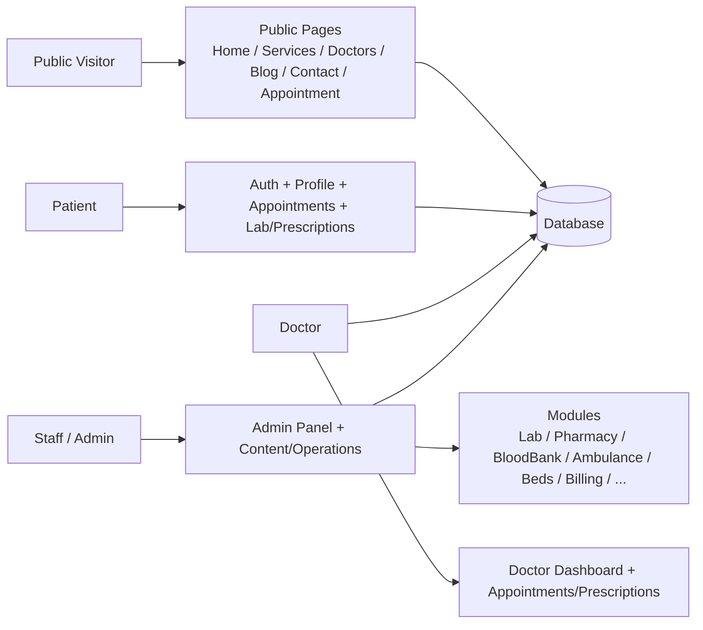

# MediCare — Project Overview (Short Doc)

> A quick, simple guide to understand the MediCare hospital project.

## What is MediCare?
MediCare is a hospital website + management portal.

- **Visitors**: learn about the hospital, read services/blogs, book appointments.
- **Patients**: create account, manage profile, book/cancel appointments, view lab/prescriptions.
- **Doctors**: review appointments, update status, manage prescriptions/profile.
- **Staff/Admin**: use admin panel to manage content, doctors, appointments, patients, settings.

## Full Project Feature Map (Short)

| Area | Features |
| --- | --- |
| Public Site | Home, About, Services, Doctors, Blog, Contact, Appointment booking, Doctor detail, Department pages |
| Appointments | Book (guest/patient), cancel, approve/complete status flow, time slots, availability |
| Patient Care | Profile, appointments, lab reports/orders, prescriptions |
| Doctor | Dashboard, appointments, prescriptions, profile/availability |
| Admin/Staff | Content (sliders/departments/services/doctors/blogs), appointments, patients, settings, modules |
| Modules | Lab, Pharmacy, Blood Bank, Ambulance, Beds, Billing, Analytics, Google Calendar, Language, Search, Vaccination, Zoom, Backups |

## Big Picture Diagram

## How It Works (Short)
- Laravel 13 + Blade + MySQL/sqlite.
- Feature modules live in `app/Modules` (Directory, Publishing, Reviews, Lab, Pharmacy, Prescriptions, BloodBank, Ambulance, Beds, Billing, Analytics, GoogleCalendar, Language, Search, Vaccination, Zoom, Backups).
- Public routes: `routes/web.php` + module routes. Admin: guarded groups.
- Content flows: Admin manages → DB → Public pages update.

## Status
- Plan stages + all follow-ups completed.
- Tests: PHP **348/348**, Playwright e2e **52/52**, Pint clean, `composer audit` clean.
- Frontend quality work (headings, labels, JSON-LD, department pages, doctor↔service relation, viewport matrix) all done & committed.

---

**Quick feature count**: ~16 feature modules + public site pages + patient/doctor/staff/admin flows = a full hospital management portal.
